<a href="https://keelinfra.io">
  <picture>
    <source media="(prefers-color-scheme: dark)" srcset=".github/readme/hero-dark.svg">
    
  </picture>
</a>

<p align="center">
  <a href="https://github.com/keelinfra/aix-runner/actions/workflows/build.yml"></a>
  <a href="https://github.com/keelinfra/aix-runner/releases/latest"></a>
  <a href="#status"></a>
  <a href="#license"></a>
</p>

<p align="center">
  <a href="#install"><b>Install</b></a> &nbsp;·&nbsp;
  <a href="#how-it-works"><b>How it works</b></a> &nbsp;·&nbsp;
  <a href="#status"><b>Status</b></a> &nbsp;·&nbsp;
  <a href="docs/install.md"><b>Docs</b></a> &nbsp;·&nbsp;
  <a href="https://keelinfra.io"><b>keelinfra.io</b></a>
</p>

<br>

Run **GitLab Runner on AIX 7.2 and 7.3** (ppc64), built from the unmodified upstream release.

**Why.** GitLab doesn't ship the runner for AIX, and AIX support is [not on its roadmap](https://gitlab.com/gitlab-org/gitlab-runner/-/issues/6324). The runner itself builds for AIX; four of its dependencies don't. aix-runner patches those dependencies and publishes the binary, so an AIX host can run GitLab CI jobs with the shell executor like any other runner.

## How it works

| Step | What happens |
|---|---|
| **1 · Upstream** | [`build.sh`](build.sh) takes the upstream gitlab-runner tag; the runner's own code is not changed. |
| **2 · Patch** | [`patch_deps.py`](patch_deps.py) patches four dependencies that don't compile for AIX: machineid, moby/term, go-billy and go-git. |
| **3 · Build** | Go cross-compiles it with `GOOS=aix GOARCH=ppc64 CGO_ENABLED=0`. A daily CI build of the latest upstream tag catches upstream changes early. |

Details: [docs/how-it-works.md](docs/how-it-works.md).

## Status

Experimental and free to use. CI on Linux builds the latest upstream release every day; runs on AIX are tested by hand, not in CI.

| Platform | Tested | Notes |
|---|---|---|
| AIX 7.3, shell executor | tested, not in CI | with 19.5.1 against gitlab.com: register, jobs, artifacts, local cache, git clone, cancel |
| AIX 7.2 | not yet | same binary, should work |
| AIX 7.1 and older | not supported | Go requires AIX 7.2 |
| Docker and Kubernetes executors | not applicable | nothing to talk to on AIX |

Running Jenkins agents on AIX 7.1, Solaris or HP-UX instead? See [Agent8](https://github.com/keelinfra/agent8).

## Install

On the AIX host (POWER8 or newer), with `git` and `bash` from the [AIX Toolbox](https://www.ibm.com/support/pages/aix-toolbox-open-source-software-overview). Download `gitlab-runner-aix-ppc64` and `sha256sums.txt` from the [latest release](https://github.com/keelinfra/aix-runner/releases/latest); AIX has no curl or wget by default, so download them elsewhere and `scp` them over, or use curl from the Toolbox. Create the runner and its token in GitLab first (Settings > CI/CD > Runners).

```sh
sha256sum -c sha256sums.txt          # or: openssl dgst -sha256 gitlab-runner-aix-ppc64
mv gitlab-runner-aix-ppc64 gitlab-runner && chmod +x gitlab-runner
mkdir -p "$HOME/gitlab-runner"

./gitlab-runner register --non-interactive \
  --config "$HOME/gitlab-runner/config.toml" \
  --url https://gitlab.example.com --token "$RUNNER_TOKEN" \
  --executor shell --env "PATH=/opt/freeware/bin:/usr/bin:/bin"
./gitlab-runner run --config "$HOME/gitlab-runner/config.toml" \
  --working-directory "$HOME/gitlab-runner"
```

> [!IMPORTANT]
> Keep the `--env PATH=...` line: the Toolbox installs git and bash under `/opt/freeware/bin`, and jobs fail to clone without it. Use an absolute `--config` path, because the runner reloads the file from that path.

<details>
<summary><b>More:</b> running in the background, checking where a binary came from, building it yourself</summary>

<br>

All of it is in [docs/install.md](docs/install.md).

</details>

## Known gaps

- Cancelling a job takes about 20 seconds: the runner learns about the cancel at its next status update for the job. The job's processes are then killed.
- Not tested yet: AIX 7.2, `gitlab-runner install` as a system service, distributed (S3/GCS) cache, long-running stability.
- The binary is about 150 MB, because the Docker and Kubernetes executors are compiled in even though they have nothing to talk to on AIX.

When you report a problem, include `oslevel -s`, `./gitlab-runner --version` and the relevant lines of the runner log.

## Get involved

A test report from AIX 7.2, a run as a system service, or a job that behaves differently from Linux is the most useful thing you can send: [open an issue](https://github.com/keelinfra/aix-runner/issues). Pull requests are welcome.

> [!NOTE]
> aix-runner is an independent project. It is not part of, or endorsed or supported by, GitLab. Please report problems [here](https://github.com/keelinfra/aix-runner/issues), not to GitLab's issue tracker.

## License

[MIT](LICENSE), like GitLab Runner itself.

This product is based on GitLab software. GitLab is a trademark of GitLab Inc. This project is not affiliated with or endorsed by GitLab Inc.

<br>

<p align="center">
  <a href="https://keelinfra.io"></a>
  <br>
  <sub>
    Part of <a href="https://keelinfra.io"><b>keelinfra</b></a>: tested, open-source builds for CI that can't upgrade yet.<br>
    <a href="https://github.com/keelinfra/agent8">Agent8 for Jenkins</a> &nbsp;·&nbsp;
    <a href="https://github.com/keelinfra/jenkins-extended-security">Extended Security for Jenkins 2.541.x</a> &nbsp;·&nbsp;
    <a href="https://keelinfra.io/jenkins/upgrade-matrix/">Jenkins upgrade matrix</a>
  </sub>
</p>
